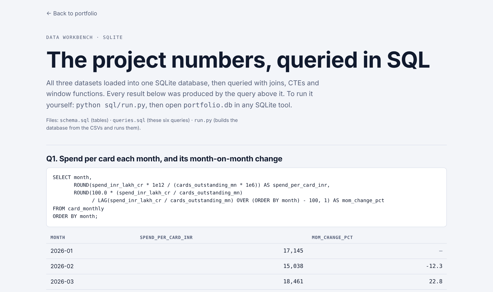

# SQL Workbench: Indian payments data

Learn and practise SQL on real Indian card and UPI numbers. Four small tables, six worked examples and eight exercises with answers, covering joins, CTEs and window functions. Runs on SQLite with nothing to install.

[Portfolio](https://abhinavspambox.github.io/) · [Results page](https://abhinavspambox.github.io/sql/) · [Dataset](https://github.com/abhinavspambox/india-payments-data)



## Quick start

```bash
python run.py                  # builds portfolio.db and runs the worked examples
python run.py solutions.sql    # runs the exercise answers
```

Then open `portfolio.db` in [DB Browser for SQLite](https://sqlitebrowser.org/) or any SQL tool.

## Tables

| Table | Rows | What it holds |
| --- | --- | --- |
| `card_monthly` | Jan–Sep 2026 | Credit cards outstanding (millions) and spend (₹ lakh crore) |
| `issuer_apr2026` | 3 issuers | Spend, cards and YoY spend growth, April 2026 |
| `upi_monthly` | Jan–Oct 2026 | UPI volume (billions) and value (₹ lakh crore) |
| `ombudsman_fy25` | 5 categories | Share of RBI Ombudsman complaints, FY25 |

Units: 1 lakh crore = ₹10¹², 1 crore = ₹10⁷.

## Exercises

Try each one before opening `solutions.sql`.

1. List the months where UPI processed more than 23 billion transactions.
2. What was the average monthly credit card spend from January to September 2026?
3. Which month had the highest spend per card?
4. Calculate month-on-month growth in UPI volume. *(Hint: `LAG`)*
5. Join the UPI and card tables. In which months did UPI move more than 14.5× the value of card spend?
6. Show the running total of cards added since January. *(Hint: `FIRST_VALUE`)*
7. What share of the three issuers' combined spend did each issuer have in April 2026? *(Hint: `SUM() OVER ()`)*
8. Find the three months with the smallest average UPI payment.

## Worked examples (`queries.sql`)

Spend per card with month-on-month change · net cards added · months where the base grew but usage fell (CTE) · issuer ranking with `RANK()` · UPI average ticket vs card spend (join) · complaint categories with a running share.

---

Part of [Abhinav Kumar Tarkar's product portfolio](https://abhinavspambox.github.io/). Figures are compiled from public RBI and NPCI releases as reported in the press; every row links to its source. Product proposals are my own and do not reflect any employer's plans.
